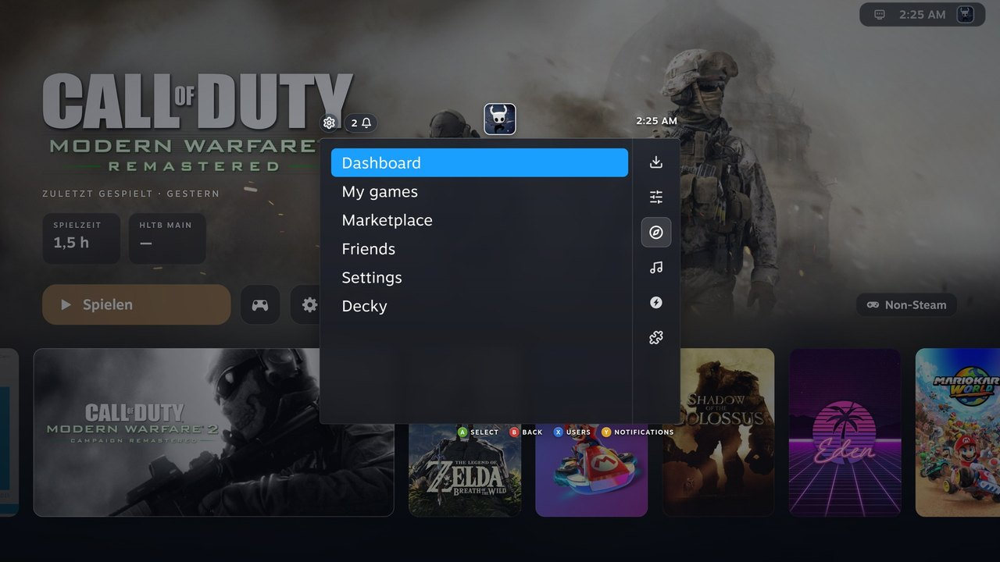
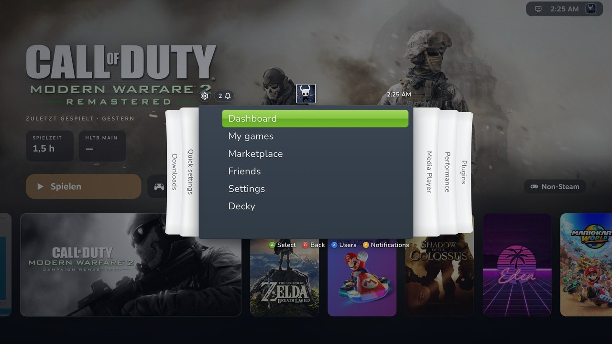
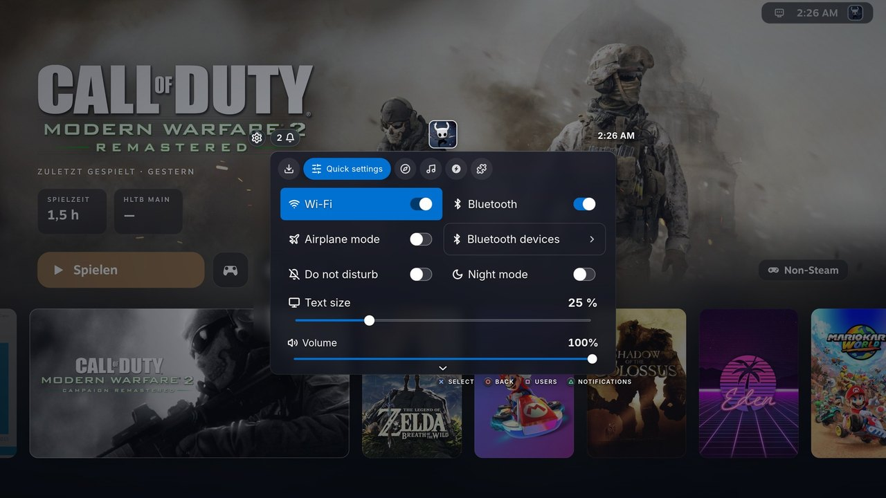
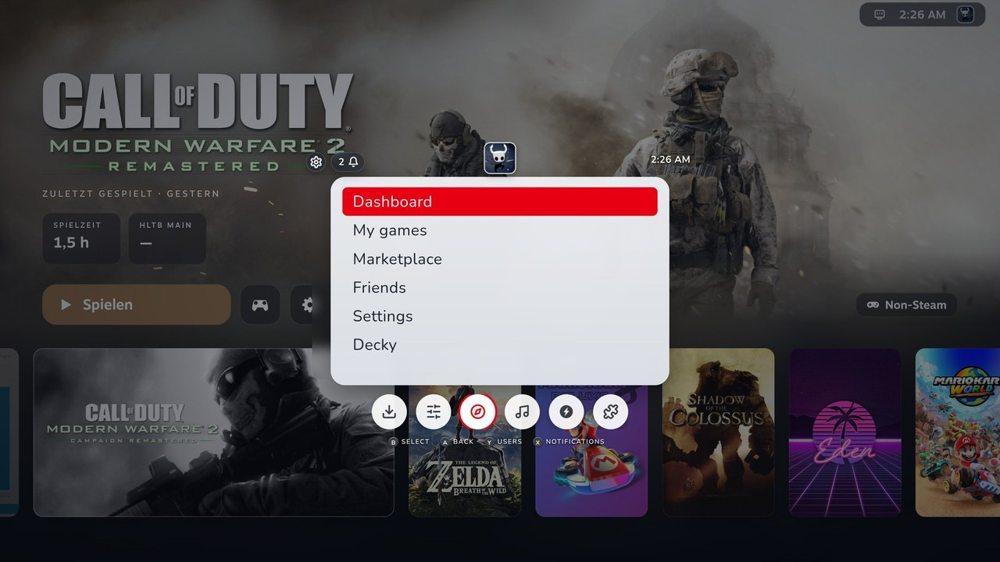
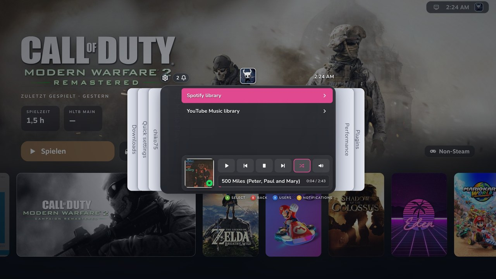
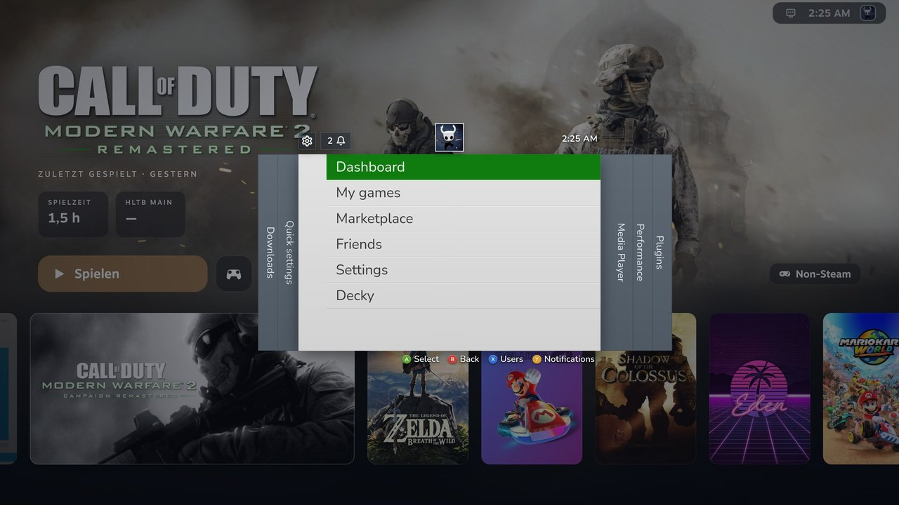
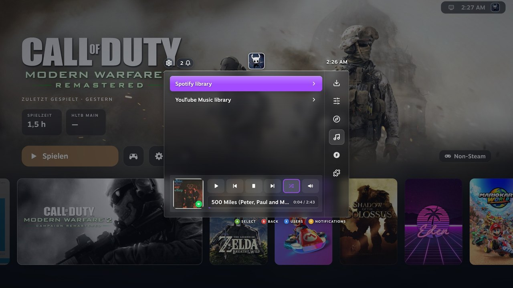
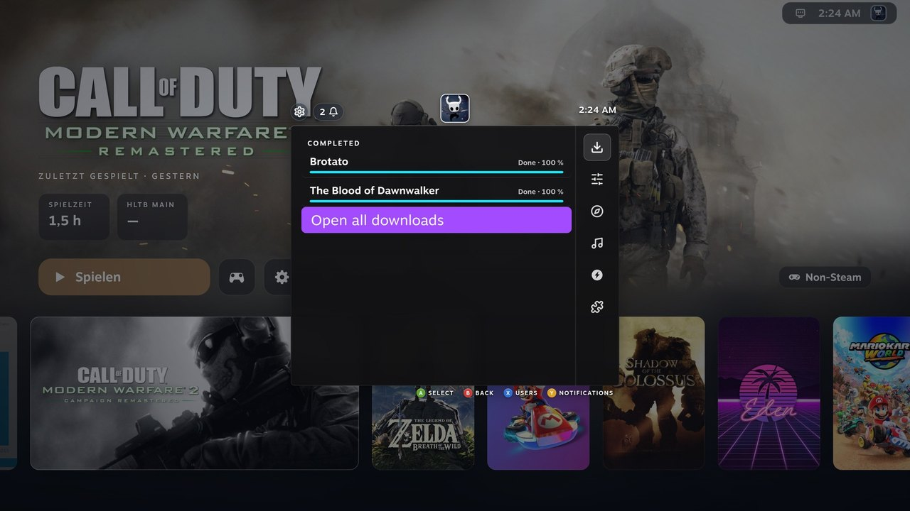
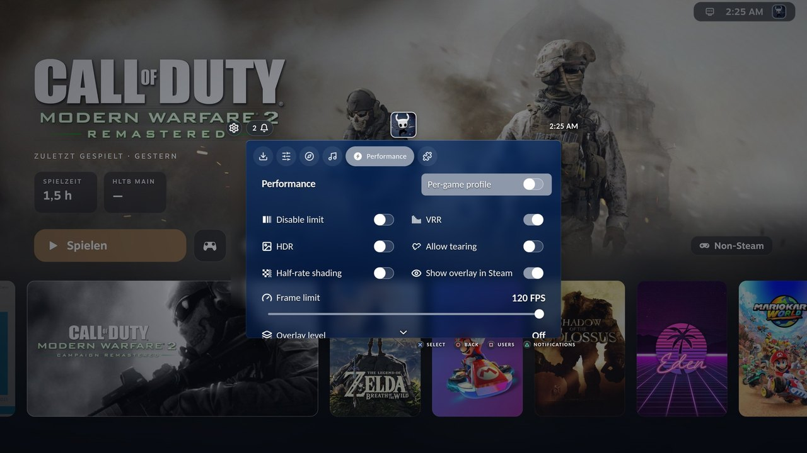
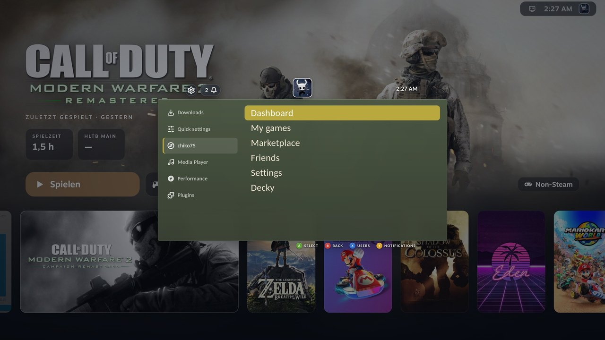

# Guided

**One guide for Steam Game Mode** (SteamOS, Bazzite, …), packaged as a [Decky Loader](https://decky.xyz) plugin.
Press the Steam button and get one menu for everything: Downloads, Quick settings, your profile/main menu, Performance, Plugins and a Media Player – in the style of Steam Deck (default), Xbox, PlayStation, Nintendo or Steam – tabs on any side, optionally as Liquid Glass.

> Guided was called **Guided360** until version 1.37. Guided360 updates itself to Guided and your settings are taken over – see [Coming from Guided360](#coming-from-guided360).

> **Based on [Game Glance](https://github.com/michpalm/game-glance) by Michael Palma (MIT).**
> Guided is a derivative work: it keeps only the menu and re-skins and extends it. See [Credits](#credits).

 
 
 
 
 

Steam Deck (default) · Classic NXE · PlayStation 5 – quick settings · Switch dock · Modern NXE Dark – Media Player · Metro · Liquid Glass – Deck OLED · Deck OLED – downloads · PlayStation 3 – performance · Steam 2004

## Features

- **Guide menu** with quick settings (brightness, volume and output device, microphone and input device, Wi-Fi and Bluetooth windows with their on/off switch, network / device search and connect, airplane mode, night mode, do not disturb, text size) and every option of Steam's Performance menu – each element can be hidden – plus downloads and Quick Resume right in the Guide window, friends with chat, notifications and user switching
- **Add games**: the controller-plus icon at the top opens a file browser and adds any program as a non-Steam game (on Linux optionally with Proton); default folders for games and plugin ZIPs
- **Settings per Steam account**: every account on the device keeps its own look, tabs and buttons
- **My games** (recent games and library, per-game options – or switch it off to go straight to Steam's library), **Achievements** in NXE style (sort and filter), **Friends** sorted by latest chat, with per-friend actions (message, voice, join, invite, profile, nickname, Remote Play Together, trade …)
- **Party**: voice chat right from the friends list, a Party row in the main menu during a call or when someone calls, and a Party window with who is speaking, mic, sound, chat, hang up and accepting / declining calls – for Steam and (with Steamcord) Discord
- **Screen sharing (Discord via Steamcord)**: watch a friend's screen share right in the Guide, in full screen or as **picture-in-picture over your game** (size and position adjustable), and **share your own screen** with a chosen quality (up to 1080p 60 fps with Nitro) – everything runs through Steamcord
- **Discord via Steamcord (beta)**: if the Decky plugin [Steamcord](https://github.com/Necrosiak/Steamcord) is installed, the switch *Settings › Guided › Adapt Steamcord* adds **Discord friends** (direct messages and group chats: read and write, call, join calls) and **Servers** (join voice channels) as tabs in the Friends window, and a Discord voice chat shows up as **Party** in the main menu (members, who is speaking, mic, sound, invite friends, hang up, accept / decline incoming calls). Guided only talks to Steamcord – nothing of it is bundled, and without Steamcord the option does not appear
- **Controller window**: controllers, player order, layouts – and editing of button bindings, input styles, activators and mode settings right in the Guide; a per-game **Steam Input** switch (like Steam's game properties)
- **Media Player** tab in the style of the Xbox 360 media blade: Spotify (the installed app, invisible in the background) or YouTube Music (sign in through Steam's browser) – your libraries, playlists and albums down to single tracks, **search** for songs and artists, full playlists of any length, one player with play/pause, previous, stop, next, shuffle, **repeat** (all / one song) and volume; only one source plays at a time, and music keeps playing while you game
- **Game volume**: the in-game tab has a slider for the volume of the running game only (Linux)
- **Quick Resume** tab for running apps plus a window switcher on the in-game tab; X closes an app after a short confirmation (experimental; works best with the "Pause Games" plugin)
- **System & Power** view (sleep, restart, shut down, desktop, restart Steam / Guided) and **Update Guided** straight from GitHub
- **Plugins tab**: Decky plugins inside the Guide (windows grow with their content), buttons for Decky settings and store, and **+** to install a plugin from a ZIP with a file browser right in the Guide
- **13 presets**: **Steam Deck** (default) and **Steam Deck OLED**; Xbox – **Modern-NXE**, **Classic NXE** (the 2008 guide, curved blades and player ring), **Metro** (2011 dashboard), **Modern NXE Dark**, **Dynamic** (colors from the running game's artwork); PlayStation – **PS5**, **PS3** (the XMB: categories in a row, content as a list, submenus open as a sub-list to the right, status bar at the top right); Nintendo – **Switch** light / dark; Steam – **Big Picture**, **2004**. A preset sets colors, shapes, sizes, font and button symbols
- **8 tab styles**, named after their look: Blades (Modern NXE), Curved blades (Classic NXE), Flat blades (Metro), Stacked cards (browser-style tabs), Pills with text (PlayStation), List with text (Steam), Icons only (Steam Deck), Round icons (Switch) – all non-blade styles can sit **on any side** (top, bottom, left, right); tab labels (icon, text or both), **gap to the window** and **tab size** for every style; window position (left / center / right, top / bottom, or custom with sliders right up to the screen edge), width up to 1800 px
- **Status bar** for every preset: profile picture, icons and clock in one frame at the top right, notifications drop down below it – optionally with your animated Steam mini profile or profile background behind it
- **One color palette** (26 colors, same order everywhere) for every color choice: accent, window, tabs, tab icons, text (also tints the icons), profile ring, Steam frame, button symbols; adjustable **tab icon size** and **bold text** for every font
- **Content as a list** and switches as **checkboxes** for any preset; presets remember your tab position, switch style and list setting
- **Open and close animations** (Guide, Steam, fade, pop, zoom, slide in four directions) with adjustable speed
- **Liquid Glass** as a switch for every preset and layout: the window and tabs turn into tinted glass, with its own blur and opacity
- **Your Steam profile in the Guide** (*Appearance › Profile picture* and *Profile banner*): the avatar frame you equipped in the Steam Points Shop (animated or still, thickness and color adjustable – incl. "like the banner" and the running game's color), animated avatars, the animated mini profile background in the name banner, and your (animated) profile background as the window background with dimming and blur. The banner's player ring can glow in any color, with 1–4 quarters lit
- **Fine-tuning**: layout independent of the preset, custom themes (rename, delete), name banner on every page or the main page only, profile picture ring (colors, rainbow), scaling, colors (window color incl. "Dynamic", window opacity and in-game blur for every style), text and font size, effects, UI sounds (off by default; for now the Xbox 360 set), player ring, glow, button symbols (Xbox / Nintendo / PlayStation, three sizes), hide/reorder tabs, choose the tab for Steam + A, remap buttons (Start, Select, X, Y and Steam + A: Steam's menu, Steam's quick access menu or any Guided tab) – every choice in a dropdown
- **Setup assistant** for new users: quick with a preset (preset, accent color, background, window size and position) or custom through every appearance page with fine tuning – start it again any time under *Settings › Appearance*
- The Guide moves above Steam's on-screen keyboard so every key stays visible – only the Guide moves, the home screen behind it stays in place
- **What's new?**: after a bigger update (1.0 → 1.1) a row under Decky in the main menu explains the most important changes once
- **Automatic update check** with a Steam notification (can be switched off)
- Sharp on every resolution and aspect ratio (4K TV, Steam Deck, Legion Go …)
- Languages: English, Deutsch, Español, Français, Português (or Auto from the Steam language)

## Install

1. Install [Decky Loader](https://decky.xyz).
2. Download the latest ZIP from [Releases](../../releases):
   `Guided-vX.Y.Z.zip`.
3. In Game Mode: Decky → settings (gear) → Developer → *Install plugin from ZIP*.
4. Restart Steam if the plugin does not appear.

**Updating:** Guided checks for a new release by itself (shortly after start, then every 6 hours) and shows a Steam notification – press it to update. Pre-releases are only offered if you already run one. You can also update any time via *Quick settings → System & Power → Update Guided*. The update is installed through Decky (you confirm in Decky).

Settings live in the Guide itself (gear icon at the top left of the Guide).

## Windows (beta)

Decky Loader also runs on Windows. For that there is a separate plugin, **Guided Windows** (`Guided-Windows-vX.Y.Z-beta.N.zip`, published as a pre-release). Install it the same way through Decky. If the Linux "Guided" is installed there, Guided Windows takes over its settings and removes it.

What is different on Windows:
- In a game, Steam shows its Guide in its own overlay window – Guided follows it there and back to Big Picture.
- With several games running, Guided always uses the overlay of the game in front.
- Spotify (desktop or Microsoft Store app) is started minimized and controlled through the app itself; YouTube Music works as on Linux.
- **Sound:** Steam has no audio controls on Windows, so Guided talks to Windows directly – volume, microphone, and output / input device in quick settings (the device choice sets the Windows default device).
- **Quick Resume with pausing** (like the "PauseGames" plugin on Linux): switching games through Quick Resume (or Alt+Tab) brings the game to the front and pauses the others – no CPU or GPU use, but they keep their RAM and video memory. A game is only paused once the new one really is in front. Games with kernel anti-cheat (e.g. Easy Anti-Cheat in Halo MCC) cannot be paused and keep running; their tile says so. Switch it off under *Settings › Guided › Pause games in the background*.
- Not available: Performance tab, Wi-Fi / Bluetooth / airplane / night mode switches and the window switcher. "Switch to desktop" becomes "Exit Big Picture".
- If the stick still moves the game while the Guide is open, the game reads the controller directly: turn on Steam Input for that game (Controller window → "Steam Input for this game", or Steam's controller settings).

Updates of Guided Windows come only from Windows pre-releases; Linux installs never see them.

## Coming from Guided360

The last Guided360 release (1.37.2) points its update at Guided: you get a notification "Guided360 is now called Guided", press it and confirm the install in Decky. Guided takes over your settings, custom themes and tab order and then removes Guided360 by itself. You can also simply install the Guided ZIP – the same happens. Guided360's settings folder stays untouched as a backup.

## Status

Active hobby project, tested on a few Linux gaming setups only. **Not every Steam client version is covered**: Steam's internal menu code changes, and things like switching to Steam pages can break after a Steam update. Bug reports are very welcome – use the issue template and add a photo.

## Building from source

This repository holds the built plugin (`dist/index.js`) plus the Python backend. The plugin is produced by patching the compiled upstream Game Glance bundle; the build scripts are described in [`BUILDING.md`](BUILDING.md).

## Credits

- **Game Glance** by [Michael Palma](https://github.com/michpalm/game-glance), MIT – the foundation of this plugin.
- Fonts: Carlito, Inter, Poppins and Nunito (SIL OFL 1.1).
- Spotify and YouTube Music are used through their own apps/websites with your own account; Guided only controls them.
- hltb-for-deck by hulkrelax (MIT), via upstream.

Details in [`THIRD_PARTY_LICENSES.md`](THIRD_PARTY_LICENSES.md) and [`LICENSE`](LICENSE).

## Disclaimer

Not affiliated with or endorsed by Valve, Microsoft, Sony, Nintendo, Spotify, Google or the Game Glance author. "Xbox", "Xbox 360", "PlayStation", "Nintendo Switch", "Steam", "Steam Deck", "Spotify", "YouTube Music" and "iOS" are trademarks of their owners and are used only to describe the visual inspiration or to name the music source.

## License

MIT. The original copyright notice (Michael Palma) is retained as required.

---

# Deutsch

Guided ist ein Guide-Menü für den Steam Game Mode (Decky-Plugin), basierend auf **Game Glance** von Michael Palma (MIT) – bis Version 1.37 hieß es **Guided360**. Ein Menü für alles: Downloads, Schnelleinstellungen, Hauptmenü, Leistung, Plugins und ein Media Player für Spotify und YouTube Music, der auch bei geschlossenem Guide weiterspielt. 13 Presets im Stil von Steam Deck (Standard), Xbox, PlayStation, Nintendo und Steam, 8 Tab-Darstellungen mit frei wählbarer Tab-Position (oben, unten, links, rechts), Abstand und Tab-Größe, Öffnen-/Schließen-Animationen, dein Steam-Profil (Rahmen, Banner, Hintergrund) im Guide, WLAN/Bluetooth/Audiogeräte in den Schnelleinstellungen, „Spiel hinzufügen“, Erfolge mit Sortieren und Filtern, frei verschiebbare Fensterposition, Einstellungen pro Steam-Konto und ein Einrichtungsassistent für neue Nutzer, dazu Liquid Glass als Schalter für jedes Preset.

**Installation:** ZIP aus den [Releases](../../releases) laden (`Guided-vX.Y.Z.zip`) und in Decky über Zahnrad → Entwickler → „Plugin aus ZIP installieren“ einspielen. Einstellungen findest du im Guide über das Zahnrad oben links.

**Von Guided360:** Das letzte Guided360-Release (1.37.2) meldet „Guided360 heißt jetzt Guided“ – drücken und in Decky bestätigen. Guided übernimmt Einstellungen, eigene Themes und Tab-Anordnung und entfernt Guided360 danach selbst. Der Einstellungsordner von Guided360 bleibt als Sicherung erhalten.

**Update:** Guided prüft selbst auf neue Versionen und meldet sich mit einer Steam-Benachrichtigung (abschaltbar unter Einstellungen → System & Updates). Manuell: Schnelleinstellungen → System & Energie → „Update Guided“. Nach größeren Updates erklärt „Was ist neu?“ im Hauptmenü die wichtigsten Änderungen.

**Hinweis:** Nach Steam-Updates kann einzelnes brechen (z. B. der Wechsel zu Steam-Seiten). Fehler bitte mit Foto als Issue melden.
