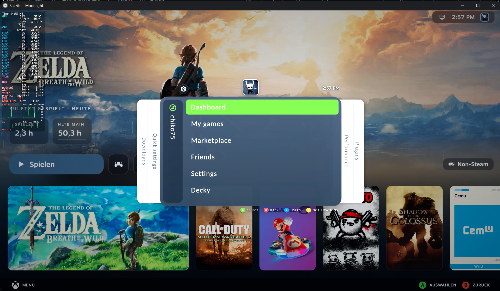
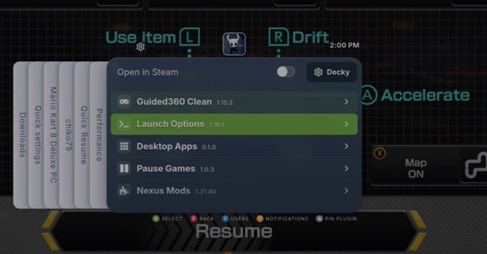
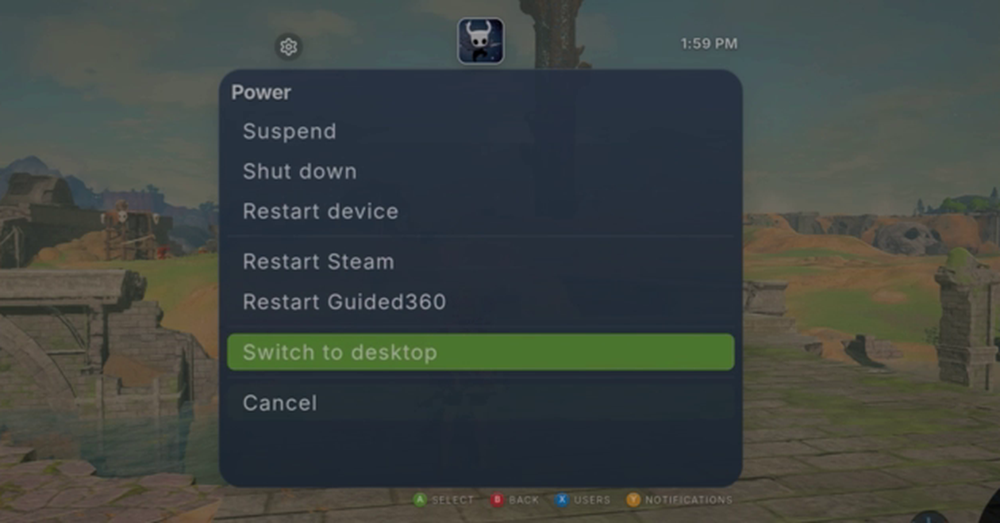

# Guided

**One guide for Steam Game Mode** (SteamOS, Bazzite, …), packaged as a [Decky Loader](https://decky.xyz) plugin.
Press the Steam button and get one menu for everything: Downloads, Quick settings, your profile/main menu, Performance, Plugins and a Media Player – in the style of Steam Deck (default), Xbox, PlayStation, Nintendo or Steam.

> Guided was called **Guided360** until version 1.37. Guided360 updates itself to Guided and your settings are taken over – see [Coming from Guided360](#coming-from-guided360).

> **Based on [Game Glance](https://github.com/michpalm/game-glance) by Michael Palma (MIT).**
> Guided is a derivative work: it keeps only the menu and re-skins and extends it. See [Credits](#credits).

  

## Features

- **Guide menu** with quick settings (brightness, volume, microphone, Wi-Fi, Bluetooth and its devices, airplane mode, night mode, do not disturb, text size) and every option of Steam's Performance menu – each element can be hidden – plus downloads, friends with chat, notifications and user switching
- **My games** (recent games and library, per-game options), **Achievements** in NXE style, **Friends** sorted by latest chat, with per-friend actions (message, voice, join, invite, profile, nickname, Remote Play Together, trade …)
- **Controller window**: controllers, player order, layouts – and editing of button bindings, input styles, activators and mode settings right in the Guide
- **Media Player** tab in the style of the Xbox 360 media blade: Spotify (the installed app, invisible in the background) or YouTube Music (sign in through Steam's browser) – your libraries, playlists and albums down to single tracks, one player with play/pause, previous, stop, next, shuffle and volume; only one source plays at a time, and music keeps playing while you game
- **Quick Resume** tab for running apps plus a window switcher on the in-game tab (experimental; works best with the "Pause Games" plugin)
- **System & Power** view (sleep, restart, shut down, desktop, restart Steam / Guided) and **Update Guided** straight from GitHub
- **Plugins tab**: Decky plugins inside the Guide (windows grow with their content), buttons for Decky settings and store, and **+** to install a plugin from a ZIP with a file browser right in the Guide
- **14 presets**: **Steam Deck** (default) and **Steam Deck OLED**; Xbox – **Modern-NXE**, **Classic NXE** (the 2008 guide, curved blades and player ring), **Metro** (2011 dashboard), **Modern NXE Dark**, **Liquid Glass**, **Dynamic** (colours from the running game's artwork); PlayStation – **PS5**, **PS3**; Nintendo – **Switch** light / dark; Steam – **Big Picture**, **2004**. A preset sets colours, shapes, sizes, font and button symbols
- **8 layouts**: Modern / Classic / Metro blades, tabs on top, dock at the bottom, sidebar left, rail right, stacked cards – with window position (left / centre / right, top / bottom)
- **Fine-tuning**: layout independent of the preset, custom themes (rename, delete), name banner on every page or the main page only, profile picture ring (colours, rainbow), scaling, colours (window colour incl. "Dynamic", window opacity and in-game blur for every style), text and font size, effects, UI sounds (off by default; for now the Xbox 360 set), player ring, glow, button symbols (Xbox / Nintendo / PlayStation, three sizes), hide/reorder tabs, choose the tab for Steam + A, remap buttons – every choice in a dropdown
- **What's new?**: after a bigger update (1.0 → 1.1) a row under Decky in the main menu explains the most important changes once
- **Automatic update check** with a Steam notification (can be switched off)
- Sharp on every resolution and aspect ratio (4K TV, Steam Deck, Legion Go …)
- Languages: English, Deutsch, Español, Français, Português (or Auto from the Steam language)

## Install

1. Install [Decky Loader](https://decky.xyz).
2. Download the latest ZIP from [Releases](../../releases):
   `Guided-vX.Y.Z.zip`.
3. In Game Mode: Decky → settings (gear) → Developer → *Install plugin from ZIP*.
4. Restart Steam if the plugin does not appear.

**Updating:** Guided checks for a new release by itself (shortly after start, then every 6 hours) and shows a Steam notification – press it to update. You can also update any time via *Quick settings → System & Power → Update Guided*. The update is installed through Decky (you confirm in Decky).

Settings live in the Guide itself (gear icon at the top left of the Guide).

## Coming from Guided360

The last Guided360 release (1.37.2) points its update at Guided: you get a notification "Guided360 is now called Guided", press it and confirm the install in Decky. Guided takes over your settings, custom themes and tab order and then removes Guided360 by itself. You can also simply install the Guided ZIP – the same happens. Guided360's settings folder stays untouched as a backup.

## Status

Active hobby project, tested on a few Linux gaming setups only. **Not every Steam client version is covered**: Steam's internal menu code changes, and things like switching to Steam pages can break after a Steam update. Bug reports are very welcome – use the issue template and add a photo.

## Building from source

This repository holds the built plugin (`dist/index.js`) plus the Python backend. The plugin is produced by patching the compiled upstream Game Glance bundle; the build scripts are described in [`BUILDING.md`](BUILDING.md).

## Credits

- **Game Glance** by [Michael Palma](https://github.com/michpalm/game-glance), MIT – the foundation of this plugin.
- Fonts: Carlito, Inter, Poppins and Nunito (SIL OFL 1.1).
- Spotify and YouTube Music are used through their own apps/websites with your own account; Guided only controls them.
- hltb-for-deck by hulkrelax (MIT), via upstream.

Details in [`THIRD_PARTY_LICENSES.md`](THIRD_PARTY_LICENSES.md) and [`LICENSE`](LICENSE).

## Disclaimer

Not affiliated with or endorsed by Valve, Microsoft, Sony, Nintendo, Spotify, Google or the Game Glance author. "Xbox", "Xbox 360", "PlayStation", "Nintendo Switch", "Steam", "Steam Deck", "Spotify", "YouTube Music" and "iOS" are trademarks of their owners and are used only to describe the visual inspiration or to name the music source.

## License

MIT. The original copyright notice (Michael Palma) is retained as required.

---

# Deutsch

Guided ist ein Guide-Menü für den Steam Game Mode (Decky-Plugin), basierend auf **Game Glance** von Michael Palma (MIT) – bis Version 1.37 hieß es **Guided360**. Ein Menü für alles: Downloads, Schnelleinstellungen, Hauptmenü, Leistung, Plugins und ein Media Player für Spotify und YouTube Music, der auch bei geschlossenem Guide weiterspielt. 14 Presets im Stil von Steam Deck (Standard), Xbox, PlayStation, Nintendo und Steam, 8 Layouts.

**Installation:** ZIP aus den [Releases](../../releases) laden (`Guided-vX.Y.Z.zip`) und in Decky über Zahnrad → Entwickler → „Plugin aus ZIP installieren“ einspielen. Einstellungen findest du im Guide über das Zahnrad oben links.

**Von Guided360:** Das letzte Guided360-Release (1.37.2) meldet „Guided360 heißt jetzt Guided“ – drücken und in Decky bestätigen. Guided übernimmt Einstellungen, eigene Themes und Tab-Anordnung und entfernt Guided360 danach selbst. Der Einstellungsordner von Guided360 bleibt als Sicherung erhalten.

**Update:** Guided prüft selbst auf neue Versionen und meldet sich mit einer Steam-Benachrichtigung (abschaltbar unter Einstellungen → System & Updates). Manuell: Schnelleinstellungen → System & Energie → „Update Guided“. Nach größeren Updates erklärt „Was ist neu?“ im Hauptmenü die wichtigsten Änderungen.

**Hinweis:** Nach Steam-Updates kann einzelnes brechen (z. B. der Wechsel zu Steam-Seiten). Fehler bitte mit Foto als Issue melden.
